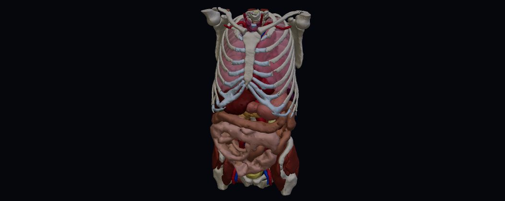

<!-- esasim: cover -->

<!-- /esasim: cover -->

<div align="center">

<!-- Banner: upload a picture named banner.png under Data › Readme pictures (a screenshot of the 3D view works well), then:  -->

# CT to 3D anatomy

**From a CT scan to coloured 3D models of every organ, bone and vessel, and soft tissue that moves under gravity.**

Open the anatomy in the browser, hide and show structures, cut through them and see the CT itself on the cut, turn the body and watch the organs move, and download STL files ready for a 3D printer. Bring your own CT: drop the folder of a CD/DVD export on the View, and a neural network segments it for you.

    [](https://esacode.com/)

</div>

> **For research and teaching only.** Not a medical device: not for diagnosis, treatment or any clinical decision.

## Overview

A CT scan is a stack of grey slices. This project turns it into a 3D model per structure (organs, bones, vessels, muscles), coloured as anatomy atlases do and grouped so you can show the skeleton alone, the organs, or the vessels. Each model is checked (pieces, holes, watertight), so the table says which ones are ready to print.

Cut through the anatomy with a plane and the cut face shows the **CT scan itself** at that place, in the grey levels a radiologist would see (soft tissue, bone or lung window), lined up with the models around it. The cut is fixed to the body: turn the model and the slice turns with it, so you can look at it face on from any side.

The second flow makes the anatomy soft. It follows the metaball soft-tissue method of **Gianluca De Novi, PhD** ([thesis, PDF](https://amsdottorato.unibo.it/id/eprint/3702/1/DeNovi_Gianluca_tesi.pdf)): each organ becomes a tree of spheres whose centres are particles joined by elastic links, the skeleton is fixed, and a skin layer from the body's outline contains the organs. The organs' own surfaces are kept: their vertices slide on the iso-surface of the spheres as these move. Each organ weighs what its volume of tissue weighs and has its own measured stiffness; organs collide with each other and with the bones, and a chest wall closes the gaps between the ribs; muscles are tied to the bones where they meet them. Turn the body with the mouse or a 3D mouse and the organs sag, sway and settle; pull one and its neighbours follow. Switch on **Metaballs** to see the spheres themselves move.

Where the scans and the segmentations come from:

| Flow | Scans | Segmentation |
|---|---|---|
| 1 · CT to 3D anatomy | TotalSegmentator dataset | **Expert labels**, drawn by hand, that come with the dataset |
| 2 · Soft tissue under gravity | TotalSegmentator dataset | **Expert labels**, as flow 1 |
| 3 · Segment any CT automatically | **Any CT**: a CD/DVD export or DICOM folder, NIfTI, NRRD, MHA, zips; loaded from the View, a worker's folder or a dataset | **Automatic**: the TotalSegmentator network, 117 structures |

## Flows

### 1 · CT to 3D anatomy (expert labels)

[**Open the blueprint →**](https://esacode.com/app/projects/6/flows/18)

A case of the TotalSegmentator dataset (s1400: neck to pelvis) read out of the online archive, checked, shown as slices with the anatomy over them, and turned into 3D models you can cut through, with the CT on the cut.

| Block | What it does |
|---|---|
| **TotalSegmentator dataset (Zenodo)** | Reads the chosen cases (the CT and the experts' masks) out of the dataset's archive, kept in the machine's cache. |
| **Read and check the scans** | Checks each scan and makes the axial, coronal and sagittal previews with the structures over them. |
| **Expert labels to 3D models** | One clean, coloured model per structure: a GLB scene for the 3D view and STL files for printing. |
| **The CT, for the cut in the 3D view** | The CT resampled into the models' own frame, as a compact volume (`<case>_ct.ctvol`) the 3D view paints on the cut. |
| **3D anatomy** | The models: parts list, cut with the CT on its face, the mouse and the 3D mouse turn the model in your hand. |
| **Slices**, **The scans**, **Every model** | The previews, the scans' details, and every model's volume and whether it is ready to print. |

### 2 · Soft tissue under gravity

[**Open the blueprint →**](https://esacode.com/app/projects/6/flows/19)

The same case as a soft-tissue model, simulated in the 3D view. The cut turns with the body here too; it shows the inside of the models, since the organs move away from where the CT saw them.

### 3 · Segment any CT automatically (TotalSegmentator)

[**Open the blueprint →**](https://esacode.com/app/projects/6/flows/118)

Any CT, loaded from your computer, a worker or a dataset, segmented by a neural network instead of by hand, and turned into the same 3D anatomy as flow 1. Every run first waits for scans from the **Load a CT** panel on the View, whether it was started with the panel's **▶ Start** or with **Run** at the top of the page. While the View is open, it waits for you. With no one at the View, after 2 minutes, it loads the demo case s1400, whose expert labels score the network. To use your own scans, see [Load your own CT scans](#load-your-own-ct-scans).

| Block | What it does |
|---|---|
| **Load a CT** (on the View) | The loading dialog: press **▶ Start** (or **Run**), drop or choose a folder from your computer, tick the series, press **③ Send**. Also: a folder on a worker, or the wired files. |
| **Demo scans** | Case s1400 of the TotalSegmentator dataset (Zenodo), with the experts' labels: loaded when no scans come from the View. |
| **Load the CT scans** | Waits for the scans the panel sends, else takes the wired files. Finds the scans in whatever it is given (a disc's DICOMDIR / DICOM / IHE_PDI folders, loose DICOM, NIfTI, NRRD, MHA, zips), groups DICOM images into series, chooses the series and writes each as `<case>/ct.nii.gz` in Hounsfield units, without patient tags. |
| **Series found in the scans** | Every series on the disc, and what was done with it (loaded, localiser, report, too few images…). |
| **Segment the CT automatically (TotalSegmentator)** | Runs the network on every scan and writes `<case>/segmentations/<structure>.nii.gz`, the layout every block after it reads. |
| **Network labels to 3D models**, **The CT, for the cut**, **The skin (no physics)** | The same blocks as flow 1, fed with the network's masks. |
| **Score the network against the experts** | Dice and volume per structure for cases that have expert labels (the demo case); for your own scans it says there is nothing to compare. |
| **Slices**, **Structures the network found**, **3D anatomy**, **Every model**, **Network vs experts** | The views. |

On the demo case s1400 the network reached a mean Dice of 0.95 against the experts (median 0.97; 99 of 110 structures above 0.9; skeleton 0.97, muscles 0.98, lungs 0.97, heart 0.95, organs 0.92, vessels 0.91). TotalSegmentator was trained on this dataset, so expect lower scores on scans from elsewhere, above all for small vessels and for structures cut by the edge of the scan.

## Load your own CT scans

Three ways, all in flow 3. The first is the usual one.

| | From this computer | From a worker's folder | From a dataset |
|---|---|---|---|
| **Where the scans are** | On the computer with the browser (a disc, a USB stick, Downloads) | On a worker's disk or a share it sees | In a dataset of the project (Data › Datasets) |
| **How** | **Load a CT** on the View: **▶ Start**, drop the folder, tick, **③ Send** | **Load a CT** › *From a worker's folder*: give the path | Wire a **Dataset** block to the loader, then **Load a CT** › *Wired files* |
| **The files travel** | Only the ticked series, compressed, browser → worker | Not at all: read in place | As the dataset is kept |
| **Keep the page open** | Yes, until the files are sent | No | No |

### From this computer: a CD/DVD export, step by step

A CT handed out on a CD or DVD usually looks like this (here the `CT2013` export):

```
CT2013/
├── DICOMDIR                     ← the disc's index (not an image)
├── DICOM/
│   └── 12840113/                ← patient
│       ├── 61922843/27976612/08551388/
│       │   ├── 1263464/         ← one series per folder: images with numbers for names, no extension
│       │   ├── 12634496/
│       │   ├── 12634522/
│       │   └── 12634582/
│       └── 61928097/31427562/
│           ├── 21161188/47658214/ , 47661610/   ← one series can be split over several folders
│           ├── 64321388/22992914/
│           ├── 96991388/23030314/
│           └── 97361388/47825714/
├── IHE_PDI/                     ← the disc's viewer: a copy of (some of) the same images, pictures, pages
├── ICON/                        ← pictures
└── REPORT/                      ← the report (PDF/HTML)
```

You do not need to find the right folder or to remove anything: **give the whole `CT2013` folder**.

**Why Start comes first:** when a run starts, EsaSim shows the views again, and the browser forgets any folder chosen before. So the run starts first, and you choose the folder once, while the run waits for it.

1. **Copy the disc to your computer** (optional but faster than reading from the drive), for example to `Documents\CT2013`.
2. **Open flow 3's View** and find the **Load a CT** panel, tab **From this computer**. (If it shows a button *Load N series and segment* and no **▶ Start**, the browser kept an old copy of the panel: reload the page with **Ctrl+Shift+R**.)
3. **① Choose the segmentation and press ▶ Start** (or **Run** at the top of the page: it does the same). **Task** (`total` for the 117 structures), **Resolution** (*1.5 mm* best; *3 mm* several times faster, fine for large organs), **Run on** (*auto*: a worker with an NVIDIA GPU; *CPU*: any worker). The run starts on a worker; in a few seconds the panel says **The worker is waiting: drop the folder with the scans here**. It waits as long as the View is open (up to 30 minutes).
4. **② Drop the `CT2013` folder** on the highlighted box, or press **Choose a folder…** and pick `CT2013` (the browser asks to confirm that the page may read the folder: it is read here, in your browser). **Choose files…** works too, for loose files.
5. **Look at the table.** The panel reads only the start of each file (the DICOM tags that say which study, series and position an image belongs to; never patient names or IDs) and lists one row per series:
   - Series are named like `A_S3_Abdomen_1.5_B30f`: study **A** (a letter per study on the disc), series number **3**, and its description from the scanner.
   - Images of one series are put together wherever they are (a series split over `47658214` and `47661610` is one row), and the copies in `IHE_PDI` are counted once.
   - Greyed and not tickable: **localisers** (the scout images), **dose reports** and other non-image series, structured reports.
   - **Images**, **Slices** (thickness), **Covers** (how much of the body, in mm) and **Size** help you choose.
   - The **best CT series of each study** is ticked and marked *best*: axial, slices of 3 mm or thinner, covering the most of the body. Tick or untick others as you like: each ticked series becomes one case. A series marked *few images* (under 20) is usually not a whole scan.
6. **③ Press the large Send N series and segment button** under the table. The panel shows the steps:
   1. *Start the run* (done).
   2. *Send the scans*: only the images of the ticked series go to the worker, compressed (a bar shows files and MB). **Keep the page open until this step is done.** A message that does not get through is tried again, and files that do not arrive are sent again by themselves.
   3. *Read the series*: the worker groups the images, puts them in order and writes each series as one scan in HU.
   4. *Segment and build the models*: the network, then the 3D models, the CT for the cut and the skin. Follow the run's progress; you can close the page now.
   5. *Done*: the 3D anatomy lists the cases (`A_S3_Abdomen_1.5_B30f`…): choose one in its list.
7. **Check the result** on **Slices** (the network's colours over the scan), **Structures the network found** (volumes in ml), **3D anatomy** and **Every model**. The masks, STL files and the scans in NIfTI are under the run's **Results**.

**To look at the series before starting:** drop the folder first (without Start): the table shows what the disc holds. **Start and send** then starts the run; as the browser forgets the folder, choose it once more when the panel asks, and press **③ Send**.

How long: reading the headers takes seconds for a few thousand files. Sending is about 250 to 300 images a minute: a disc of 780 images (about 1 GB, about 200 MB compressed) takes about 3 minutes. Segmenting takes 1 to 3 minutes a case on an NVIDIA GPU, 12 to 15 minutes on a CPU at 1.5 mm (a few minutes at 3 mm).

### From a worker's folder

For scans already on a worker (a disc copied to its disk, a network share), nothing is sent from your browser:

1. **Load a CT** › **From a worker's folder**.
2. **Folder on the worker**: the full path as that worker sees it, such as `D:\CT2013`, `\\server\share\CT2013` or `/data/ct/CT2013`. Give the top folder: every file under it is looked at.
3. **Series**: *The best CT series of each study* (as above), *Every CT series*, or *Only these series* with **Series to load**: numbers, descriptions or part of them, separated by commas (such as `3, 5` or `Abdomen 1.5`). A first run lists them all in **Series found in the scans**.
4. Choose the segmentation and press **Load and segment**. The run must go to the worker that holds the folder: choose it in the run panel.

### From a dataset

1. Project › **Data › Datasets**: a new dataset, in *EsaSim storage* (files go to EsaSim's servers) or in a worker's *Storage* folder (they stay on that machine). Upload the scans in any of the layouts below; a whole disc can go as **one zip** (`CT2013.zip`), unpacked by the loader.
2. In flow 3's editor, add a **Dataset** block (Data), choose the dataset and **Version** `latest`, and connect its **Files** to the **Files** input of **Load the CT scans**, in place of **Demo scans**. Leave **Only these files** at `*`: disc images often have no extension.
3. If the dataset has expert labels (below), also connect **Files** to **Experts** of the score block.
4. Run from **Load a CT** › **Wired files**. (With **Run** at the top of the page, the wired files are loaded only when no scans come from the View within 2 minutes.)

### What the loader reads

| You give | It makes |
|---|---|
| A CD/DVD export (DICOMDIR, DICOM/, IHE_PDI/, viewer files), or any folder of DICOM files, with or without `.dcm` | One case per chosen series, named `A_S3_Abdomen_1.5_B30f`. Compressed DICOM (JPEG, JPEG-LS, JPEG 2000, RLE) and enhanced multi-frame CT are read too. |
| NIfTI (`.nii`, `.nii.gz`), NRRD (`.nrrd`, `.nhdr` with its data), MHA, MHD (with its `.raw`) | One case per file, named after the file, or after its folder when the folder holds only that scan (`case07/ct.nii.gz` → `case07`). |
| A zip of any of these | Unpacked, then as above. |
| Files in `segmentations/`, `masks/` or `labels/` folders, label maps (whole numbers ≥ 0, under 64 values) | Not scans: skipped. Expert masks in `<case>/segmentations/<structure>.nii.gz` (same grid as the CT, TotalSegmentator's names such as `liver`, `kidney_left`, `vertebrae_L1`) are what the score compares with. |
| DICOMDIR, pictures, web pages, PDFs, localisers, dose reports, structured reports | Skipped and listed in **Series found in the scans**. |

The CT is written in **Hounsfield units**, 16-bit. MR scans are kept when **Modalities** says `CT, MR` (the panel does it when you tick an MR series) and need the task `total_mr`; the CT on the cut and the skin assume CT values.

### Privacy

- In the browser, **Load a CT** reads only the tags that group and order the images (study and series IDs, series number and description, image type, position, orientation, size, slice thickness). It never reads patient names, IDs, dates of birth or the pixel data of the series you do not tick.
- Only the ticked series are sent, to the worker that runs the flow (through EsaSim), compressed.
- The worker writes **pixels and geometry only**: the NIfTI files carry no DICOM tags. The case names come from the series description: check that your scanner does not put a name there.
- The received DICOM files stay in the run's folder on the worker until the run is deleted.
- Use only scans you are allowed to use (ethics approval, consent, data protection). For scans that must never leave your machines, use **From a worker's folder** or a dataset in a worker's folder.

### If something goes wrong

| What you see | Why, and what to do |
|---|---|
| No **▶ Start** button; the panel says *Load N series and segment* | The browser kept an old copy of the panel: reload the page with **Ctrl+Shift+R**. |
| The 3D anatomy shows the demo case (s1400), not your scan | The run loaded the wired files: no scans came from the View within 2 minutes, or the run was started from the editor with the View closed, or with *Wired files*. Keep the View open, press **▶ Start** (or **Run**), drop the folder and press **③ Send**. |
| *This run is not waiting for scans: it is loading the wired files* | The run is already loading the demo case. Press **Stop** at the top of the page, then **▶ Start**, and send your folder. |
| After Start, the panel stays on *The run started: waiting for the loader…* | The run waits for a worker, or the demo case is being read first (a few seconds). Check the run's log; with **Run on** *auto* the run needs a worker with an NVIDIA GPU online. |
| The panel lists **no series** | The folder holds no DICOM images (only pictures or a viewer): look for the `DICOM` folder of the disc, or for `.dcm` files. |
| Every series is greyed | Only localisers or reports were found, or all series are MR (tick them and choose the task `total_mr`). |
| *A run is already going* | Wait for it to end, or stop it with **Stop** at the top of the page, then press **▶ Start** again. |
| *The run is waiting for your scans: drop the folder…* after choosing it | The page showed the views again when the run started (you chose the folder before **Start**): choose it once more and press **③ Send**. |
| *Sending stopped* | The run ended, or EsaSim did not answer for several tries: if the run is still waiting, press **③ Send** again (after a page reload, drop the folder first); it goes on with the files the worker does not have yet. |
| The run's progress stays at about 15% and the log repeats *Received N of M files* | The transfer stopped (the page was closed or reloaded while sending). Open the View, drop the folder and press **③ Send**: the run takes the rest. |
| *No scans arrived from the view in 30 minutes* (run log) | The run started but nothing was sent: press **▶ Start** again and drop the folder while the panel says the worker is waiting. |
| *The folder … does not exist on this worker* | The path is wrong, or the run went to another worker: choose the worker in the run panel. |
| *No scan to segment* | Every series was skipped: **Series found in the scans** says why for each. With *Only these series*, check **Series to load**. |
| *not evenly spaced (missing images?)* | Images of the series are missing on the disc: the scan is still made, but check the slices. |
| *no value below …: not in Hounsfield units?* | The scan was exported as pictures, not CT values: export it again as DICOM. |
| *No CUDA GPU seen by PyTorch: segmenting on the CPU*, with *nvidia-smi: … insufficient permissions* | The EsaSim worker runs under an account that may not use the GPU (a Windows service or a restricted user). Run the worker as the signed-in user, or give its account access to the NVIDIA driver (run as administrator); then the log says *Segmenting on the GPU*. The run goes on meanwhile, on the CPU. |
| *TotalSegmentator stopped on …* | Its message follows. Most often: no internet on the first run (the weights, about 1.2 GB, are downloaded once into the worker's `~/.totalsegmentator`), or not enough memory for a very large scan: try *3 mm (fast)*. |
| Network vs experts is empty | Your scans have no expert labels: normal. |

## What you need

- A machine with the EsaSim worker (Project › Compute). Flows 1 and 2: any machine, no GPU needed. Flow 3: a worker with an NVIDIA GPU for **Run on** *auto* or *NVIDIA GPU*, the worker running under an account allowed to use the GPU; or any worker with *CPU*.
- Internet access on that machine: the demo case is read from Zenodo the first time and kept in its cache; flow 3 also downloads the network's weights once (about 1.2 GB). Your own scans are never sent anywhere by the network, and TotalSegmentator's usage statistics are turned off.
- Python packages, installed by the worker the first time: `SimpleITK`, `numpy`, `scipy`, `scikit-image`, `trimesh`, `fast-simplification`, `pillow`, `requests`; for flow 3 also `pydicom`, `TotalSegmentator` and `torch` (a CUDA build for the GPU).
- A computer with a recent browser (Chrome, Edge or Firefox; WebGL 2) to open the 3D view and, for **Load a CT**, to read a folder: the CT on the cut and, in flow 2, the simulation run on the computer that shows it.
- No account or key.

## How to run it

1. Under **Compute**, check that a machine is available for this project (for flow 3 on the GPU: a machine with an NVIDIA GPU).
2. Flows 1 and 2: open the flow under **Blueprint**; to change the case, set **Cases** of the download block: names such as `s1400, s0513` (the 3D view then has a list to choose one), or a number (taken at random, repeatably). Press **Run**: the first run reads the case (about 30 MB) out of the dataset's archive; the next runs use the cache.
3. Flow 3: open its **View** and use **Load a CT** ([Load your own CT scans](#load-your-own-ct-scans)). For the demo case: **Load a CT** › **Wired files** › **Load and segment**.
4. Open the **View**.
5. To look inside: in the Parts list, choose a cut (**Cut across**, **Front to back**, **Side to side**), move it with the slider, and choose what the **Cut face** shows. Drag to turn the body until the cut faces you; **⇄** keeps the other side.

## What you get

- **3D anatomy**: each tissue has its own procedural surface under a wet coat (liver lobules, bowel folds, muscle fibres, the heart's folds and fat, the lung's air sacs, bone darker and yellowish in its hollows…); **Tissue textures** in the Parts list turns it off. In the Parts list, show or hide each group or structure, find one by name; point at a model to see its name. The list folds into a button. The mouse drag and the 3D mouse turn the model in your hand (Ctrl + drag moves it).
- **Cut with the CT on it**: a plane across, front to back or side to side, fixed to the body so it turns with it. Its face shows the scan at that place:

  | Cut face | Shows |
  |---|---|
  | **CT · soft tissue** (default) | Organs, muscle, fat and vessels (window 400 HU around 40 HU) |
  | **CT · bone** | Bone structure (window 1800 HU around 400 HU) |
  | **CT · lung** | Lung tissue and airways (window 1500 HU around −600 HU) |
  | **Inside of the models** | The models' inner surfaces, without the CT |

  Only the body is painted: the air and the table around it stay clear. The CT is resampled at about 2.7 mm per voxel for this case (**Size** on the CT block: 256 voxels on the longest side; up to 512 for a sharper slice and a larger file).
- **Soft tissue** (flow 2), at the top of the Parts list: Gravity (0 to 3 g), Softness, Damping, Pause, Reset, **Pull** to drag an organ, and **Metaballs** to see the spheres of the model move (the anatomy turns see-through around them). "Lying on the back is at rest" takes away the gravity the scan was taken under (the patient lay on the back), so the organs move only when the body is turned from that pose.
- **Slices**: axial, coronal and sagittal slices of the scan, with the structures coloured over them.
- **Tables**: every structure with its volume (ml), triangles and whether it is ready to print; in flow 2, its tissue, number of spheres, links to bone, volume (ml), mass (g), stiffness and density; in flow 3, the series found on the disc (`series.csv`), the structures the network found (`segmentation.csv`) and, with expert labels, the Dice of each (`score.csv`, `summary.json`).
- **Scans and masks** (flow 3), under the run's **Results**: `<case>/ct.nii.gz` (the scan in HU, no patient tags) and `<case>/segmentations/<structure>.nii.gz`, one per structure, usable in 3D Slicer or any other tool.
- **STL files**, in millimetres, one per structure, under **Results** (they stay on the machine until you download them).
- **CT volume** (`<case>_ct.ctvol`), for the 3D view: the scan in the models' frame (x to the patient's left, y up, z towards the face, metres), 8-bit, compressed (about 2 MB a case).

## Data, method and licences

- **TotalSegmentator dataset v2.0.1, small subset** (102 CT scans with segmentations of 117 structures), [Zenodo record 10047263](https://zenodo.org/records/10047263), licence **CC BY 4.0**. Wasserthal J., Breit H.-C., Meyer M.T., et al. *TotalSegmentator: Robust Segmentation of 104 Anatomic Structures in CT Images.* Radiology: Artificial Intelligence 2023; 5(5): e230024. The scans are anonymised by their publishers.
- **Segmentation network** (flow 3): [TotalSegmentator](https://github.com/wasserth/TotalSegmentator) (nnU-Net), same citation as above, Apache-2.0; only its open tasks are offered. It runs in its own process on the worker; its anonymous usage statistics are turned off by the block.
- **DICOM reading**: [pydicom](https://pydicom.github.io/) for the tags and [SimpleITK](https://simpleitk.org/) (GDCM) for the pixels, on the worker; in the browser, a small reader of the tags that group and order the images.
- **Soft-tissue method**: Gianluca De Novi, PhD. *Soft Tissue Modeling for Virtual Reality Surgery Simulator with Haptic Feedback.* PhD thesis, Università di Bologna, 2011 ([AMS Dottorato](https://amsdottorato.unibo.it/id/eprint/3702/), [PDF](https://amsdottorato.unibo.it/id/eprint/3702/1/DeNovi_Gianluca_tesi.pdf)). Here: sphere trees by medial axis approximation from the segmentation, spring-damper links, a fixed skeleton (each bone covered by as many spheres as it needs), a chest wall of fixed spheres between the ribs (the intercostal muscles are not segmented), a skin layer, contact between structures and with the bones, muscles tied to the bones by elastic links where they touch them, masses from each structure's real volume (shared by its spheres in proportion to their volumes), and the organs' surfaces sliding on the iso-surface of their spheres (no marching cubes at run time: the surfaces come from the segmentation).
- **Tissue values**: the stiffness of liver, spleen, pancreas, kidney, thyroid and muscle is as measured in healthy adults by shear-wave elastography ([Viceconti et al., World J Radiol 2025](https://www.wjgnet.com/1949-8470/full/v17/i11/111651.htm); [Arda et al., AJR 2011](https://avesis.ankara.edu.tr/yayin/bb4273a5-b04a-4164-ab2e-9579f52e1cfa/quantitative-assessment-of-normal-soft-tissue-elasticity-using-shear-wave-ultrasound-elastography)); the other tissues use orders of magnitude from the literature. The values are the same for every patient: the motion is plausible, not validated. A Tissues table can change them.
- The code of the blocks is EsaSim's.
- **Your own scans** are yours: check that you may use them before loading them (see [Privacy](#privacy)).

## Notes

- The 3D scene of a case is lightened to about 300,000 triangles so it opens quickly in the browser; the STL files keep every triangle.
- Thin structures (small vessels, ribs) can break into pieces at the scan's resolution: the table says so.
- The CT on the cut is a resampled copy for viewing (8-bit, about 10 HU per grey level): fine for teaching, not for measuring densities. The body outline that keeps the air clear is found automatically; a patient table touching the body can be painted with it.
- The tissue that is not segmented (fat, membranes) holds each organ near its place with a soft support; the organs do not touch the skin's inner side everywhere.
- A large case can be more than a computer can simulate in real time: the view stays smooth and the tissue moves in slow motion (the Soft tissue line says how fast).
- The tissue textures and the CT on the cut are computed by the graphics card for every pixel; on a very old or weak graphics card, turn the textures off if the view feels slow.
- The network's masks are a first draft, not a reading: check them on the slices before relying on a model, above all on scans unlike those the network learned from (children, implants, strong contrast, cropped fields of view).
- The soft-tissue model of flow 2 can use the network's masks too: add **Load the CT scans** and **Segment the CT automatically** to flow 2 and wire the segmentation's **Segmented cases** into the Soft body model's **Labels** and **Scans** instead of the dataset's files.

<!-- esasim: files of the project -->

---

An [EsaSim](https://esacode.com/) project of the workspace Gianluca De Novi's workspace (Medical & healthcare).

### Blueprints in this repository

- [1 · CT to 3D anatomy (expert labels)](blueprints/1-ct-to-3d-anatomy-expert-labels.json) · 9 blocks · version 5
- [2 · Soft tissue under gravity](blueprints/2-soft-tissue-under-gravity.json) · 5 blocks · version 6
- [3 · Segment any CT automatically (TotalSegmentator)](blueprints/3-segment-any-ct-automatically-totalsegmentator.json) · 16 blocks · version 6

### Workspace blocks it uses

- [Expert labels to 3D models (clean)](blocks/ws-expert-labels-to-3d-models-clean) · version 2
- [CT volume for the 3D view](blocks/ws-ct-volume-for-the-3d-view) · version 5
- [Soft body model (skin inside)](blocks/ws-soft-body-model-skin-inside) · version 19
- [3D view (stable soft tissue)](blocks/ws-3d-view-stable-soft-tissue) · version 125
- [Load CT scans (DICOM discs, NIfTI, NRRD, MHA)](blocks/ws-load-ct-scans-dicom-discs-nifti-nrrd) · version 6
- [Segment CT automatically (TotalSegmentator)](blocks/ws-segment-ct-automatically-totalsegmen) · version 9
- [Score segmentation against experts](blocks/ws-score-segmentation-against-experts) · version 2
- [Load a CT](blocks/ws-load-a-ct) · version 14

### Assets

The files the project's views draw with (3D models, textures, sounds), in [assets/](assets/):

- [textures/esacode-logo.png](assets/textures/esacode-logo.png) · 25 KB

Keys pasted in blocks (secret settings) are not saved here, nor are the team and the results of runs.
